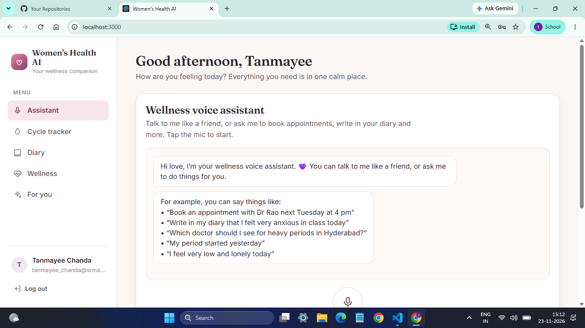
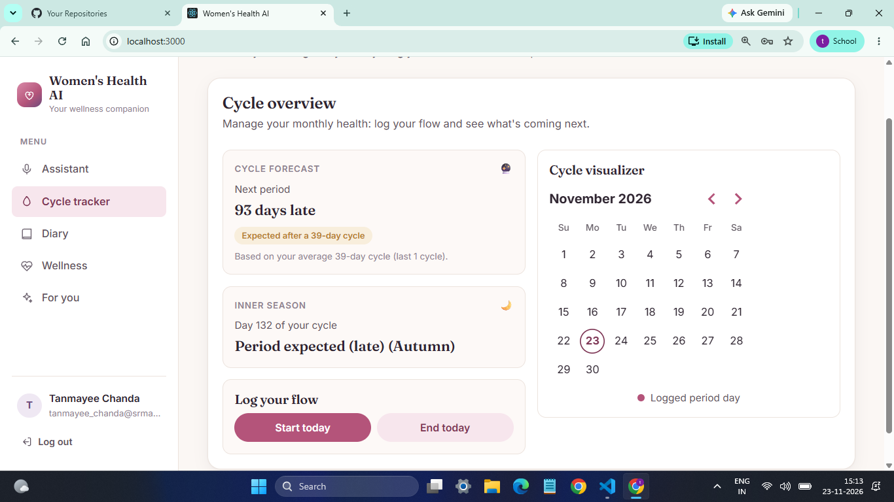
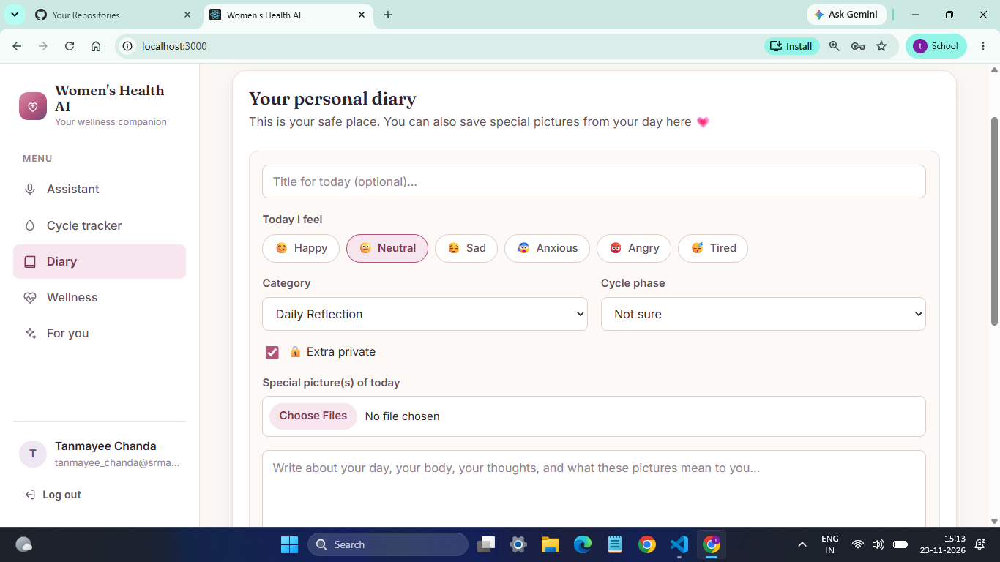
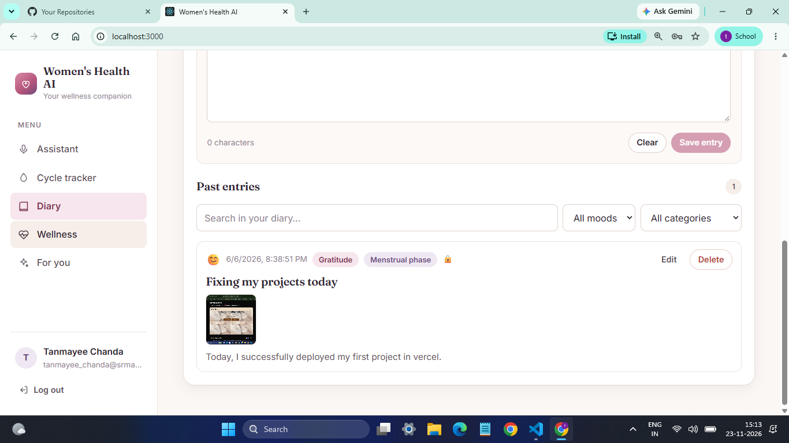
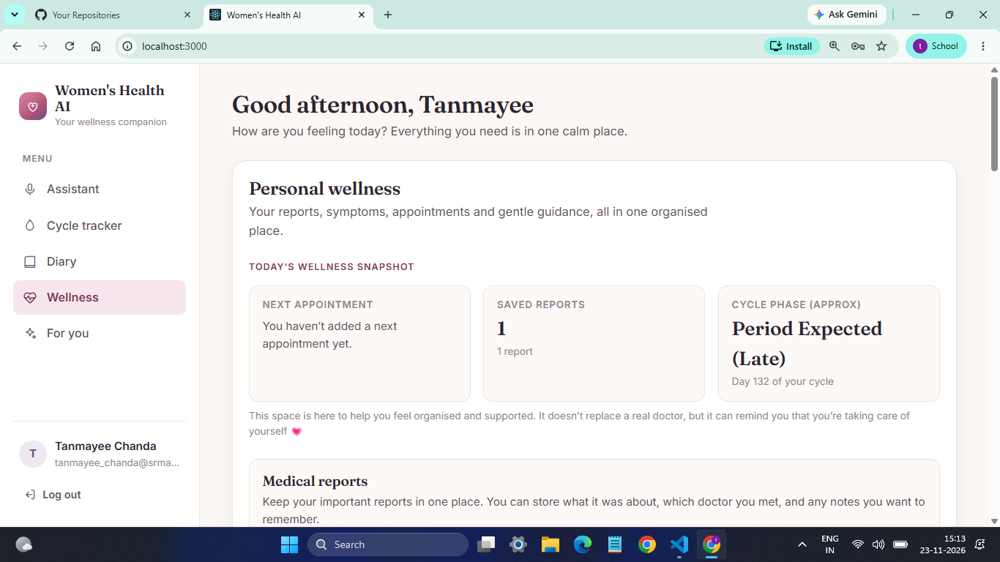
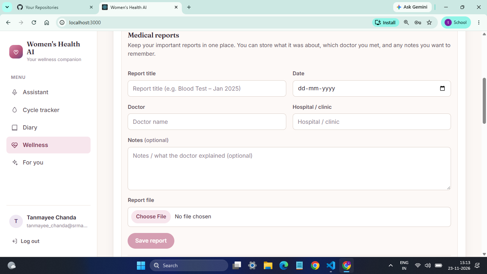
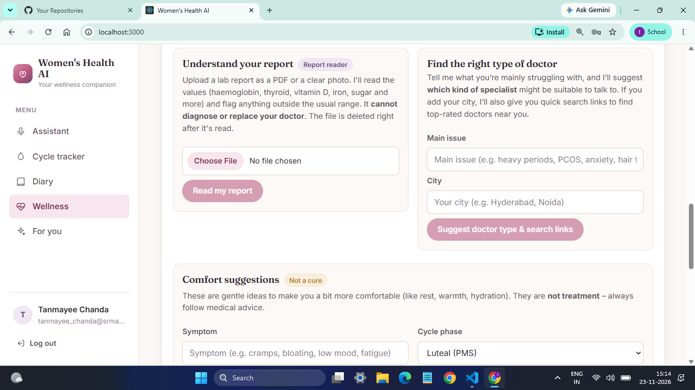
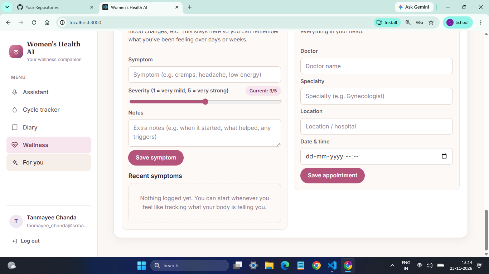
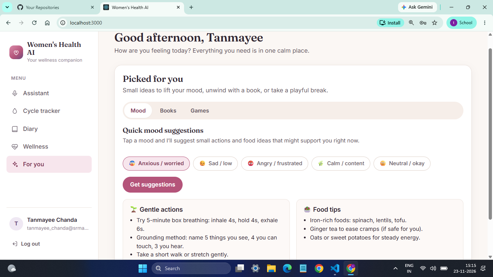

# Sakhi 🌸

*Sakhi (सखी) means "a close friend" in Hindi and Sanskrit, and that's exactly what this app tries to be.*

**A calm, private space to track your cycle, write down how you feel, keep your medical reports in one place, and talk things through with a gentle voice assistant.**

Most health apps feel either clinical or noisy. I wanted something that feels like a kind friend who also happens to remember your period dates, your doctor's appointment, and what your last blood test said. So I built it.



---

## Why this exists

Women's health gets scattered fast. Period dates live in one app, lab reports sit in a WhatsApp chat, the gynaecologist's appointment is a sticky note, and how you actually *felt* that week isn't written down anywhere. When you finally sit with a doctor, you're trying to remember all of it from memory.

Sakhi puts all of that in one place, behind your own login, and adds a little warmth on top: a voice assistant you can just talk to, mood-based suggestions, and plain-English explanations of your lab values.

> 💛 **Please note:** this app is a companion, not a doctor. It never diagnoses anything. If something feels wrong, please see a real healthcare professional.

---

## What you can do

### 🎙️ Talk to the assistant
Tap the mic and just speak, the way you'd talk to a friend. The assistant can:
- **Book appointments for you.** Say *"Book an appointment with Dr Rao next Tuesday at 4 pm"* and it understands natural dates like "tomorrow evening" or "12 December".
- **Write in your diary.** Say *"Dear diary, I felt really anxious in class today"*.
- **Point you to the right doctor.** Ask *"Which doctor should I see for heavy periods in Hyderabad?"*
- **Listen when you're low.** It responds kindly to stress, sadness, loneliness and anger, and suggests small grounding exercises.

You always see what it heard before it's sent, so you can fix any word it got wrong. Replies are read aloud too.

### 🩸 Cycle tracker
Log your period days on a calendar and the app does the maths:
- the **next expected period**, based on *your* average cycle length, not a generic 28 days
- which **phase** you're in, gently framed as your "inner season" (Winter, Spring, Summer, Autumn)
- your likely **fertile window**



### 📔 Private diary
A safe place for your thoughts. Each entry can have a mood, a category, the cycle phase you were in, and photos from your day. Search and filter past entries whenever you want to look back.

| Write a new entry | Look back on past entries |
| --- | --- |
|  |  |

### 🩺 Wellness hub
Everything medical, organised:
- **Medical reports.** Upload and keep your reports with the doctor, hospital and notes.
- **Understand your report.** Upload a lab report (PDF or a clear photo) and the app reads the values (haemoglobin, thyroid, vitamin D, iron, B12, sugar, cholesterol and more). It flags anything outside the normal range in simple language. Photos are read with OCR, and the file is deleted right after.
- **Find the right type of doctor** for what you're dealing with, with search links for your city.
- **Comfort tips** for symptoms like cramps, bloating or fatigue, tuned to your cycle phase.
- **Symptom log** with a 1–5 severity scale, so you can spot patterns over time.
- **Appointments**, with your next one always visible at the top.

| Today's snapshot | Medical reports |
| --- | --- |
|  |  |
| **Report reader & doctor finder** | **Symptom log & appointments** |
|  |  |

### ✨ For you
Pick how you're feeling and get small, doable ideas, plus comforting food tips. There are also curated **books** and **games** for when you need a gentle break.



### 📱 Works on your phone too
The layout adapts to small screens, with the menu moving to a scrollable bar at the top.

### 🔐 Sign in your way
Email and password, or one tap with Google. There's also a "forgot password" link that emails you a reset.

---

## Your privacy matters

This app holds sensitive information, so privacy isn't an afterthought:

- **Everything is tied to your account.** Every record is saved against your user ID, and you can only ever see your own.
- **Uploaded files are not public.** Reports and diary photos are only served to their owner, after checking your login token. There are no open file links.
- **Uploads are checked.** File types and sizes are limited.
- **Login is protected.** Repeated login and password-reset attempts are rate-limited to slow down guessing.
- **Passwords are hashed** with bcrypt. Google accounts can't be logged into with a guessable password.
- **Report photos are read, then deleted.** They aren't kept on the server.

---

## How it's built

| Part | What it uses |
| --- | --- |
| Frontend | React 19, React Router, a hand-made design system (no CSS framework) |
| Voice | The browser's built-in Web Speech API, for listening and for speaking replies |
| Backend | Node.js + Express 5, JWT login, bcrypt, Multer for uploads, Nodemailer for reset emails |
| Database | MongoDB (Atlas) via Mongoose |
| Report reading | `pdf-parse` for PDFs, `tesseract.js` OCR for photos |
| Date understanding | `chrono-node`, so "next Tuesday at 4" just works |

A quick, honest note on the "AI": the assistant runs on carefully written rules and free, open-source tools rather than a paid language model. That keeps it **free to run, fast, and private**, because nothing you say is sent to a third-party AI service. Plugging in a large language model later is on the roadmap.

> 🎤 Voice works best in **Chrome** or **Edge**. Firefox doesn't support speech recognition yet.

---

## Run it on your computer

**You'll need:** Node.js 18 or newer, and a free [MongoDB Atlas](https://www.mongodb.com/atlas) database (or a local MongoDB).

**1. Get the code and install everything**

```bash
git clone https://github.com/tanmayeechanda/WomenHealthAI.git
cd WomenHealthAI
npm install
cd backend && npm install
cd ../frontend && npm install
cd ..
```

**2. Add your settings**

Copy `backend/.env.example` to `backend/.env` and fill it in:

| Variable | What it's for |
| --- | --- |
| `MONGO_URI` | Your MongoDB connection string |
| `JWT_SECRET` | A long random string used to sign logins. Generate one with `node -e "console.log(require('crypto').randomBytes(48).toString('hex'))"` |
| `PORT` | API port (default `4000`) |
| `FRONTEND_URL` | Where the frontend runs, used in password-reset links (default `http://localhost:3000`) |
| `GOOGLE_CLIENT_ID` | *Optional.* For "Continue with Google" |
| `EMAIL_USER` / `EMAIL_PASS` | *Optional.* A Gmail address and App Password for reset emails. If left empty, reset links are printed in the backend console instead. |

For the frontend, you can optionally create `frontend/.env` with:

```env
REACT_APP_API_URL=http://localhost:4000/api
REACT_APP_GOOGLE_CLIENT_ID=your-google-client-id
```

**3. Start it**

```bash
npm run dev
```

That starts both the app at **http://localhost:3000** and the API at **http://localhost:4000**. Sign up, and you're in. 🌷

---

## Project structure

```
WomenHealthAI/
├── backend/
│   ├── index.js            # Express app setup
│   ├── middleware/auth.js  # checks the login token on every private route
│   ├── models/             # User, PeriodEntry, DiaryEntry, SymptomEntry,
│   │                       # MedicalReport, Appointment, WellnessProfile
│   ├── routes/             # auth, ai, period, diary, symptoms, medical,
│   │                       # appointments, resources, files, wellness
│   └── utils/
│       ├── cycle.js            # one shared place for cycle-phase maths
│       └── reportAnalyzer.js   # reads lab values from PDFs and photos
├── frontend/
│   └── src/
│       ├── App.js              # login vs dashboard, password-reset route
│       ├── theme.css           # the design system
│       └── components/         # Dashboard, AIChatVoice, PeriodLogger, Diary,
│                               # WellnessPage, MoodSuggest, Books, Games …
└── docs/screenshots/       # images used in this README
```

---

## What's next

Things I'd love to add:

- 🤖 An optional language model for richer, more personal conversations that know your cycle phase and recent moods
- 📊 An insights page showing how your symptoms and moods change across your cycle
- 🔔 Email reminders before appointments and your expected period
- 📝 Logging period end date and flow from the tracker
- ⚙️ A settings page to export your data or delete your account
- 🌙 Dark mode and an installable app (PWA)
- ✅ Automated tests

Ideas and pull requests are very welcome.

---

## A gentle reminder

Sakhi is here to help you stay organised and feel supported. It is **not** a medical device and does **not** give diagnoses. For anything that worries you, such as severe pain, very heavy bleeding, or thoughts of harming yourself, please reach out to a doctor or a local emergency helpline straight away. 💜

---

<p align="center">Made with care by <a href="https://github.com/tanmayeechanda">Tanmayee Chanda</a></p>
